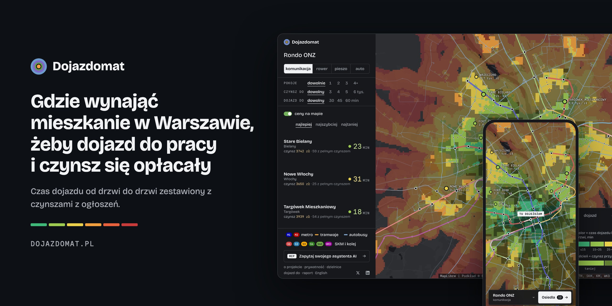
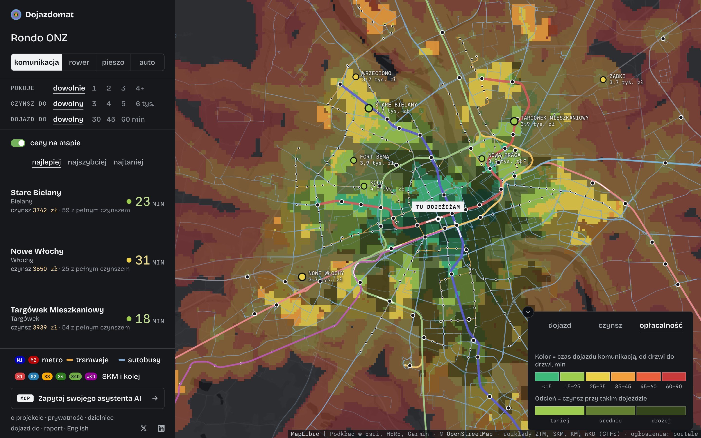
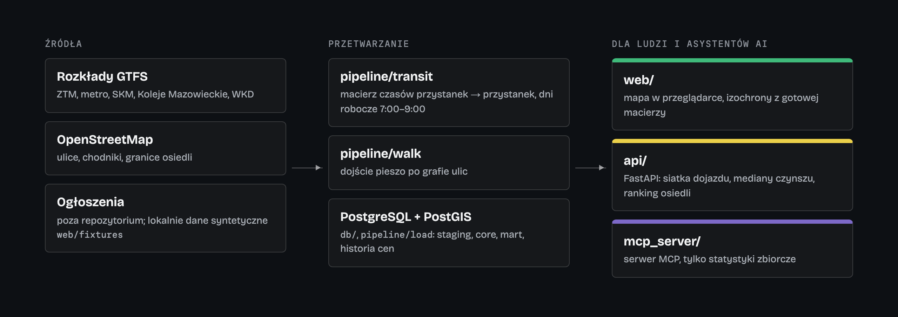
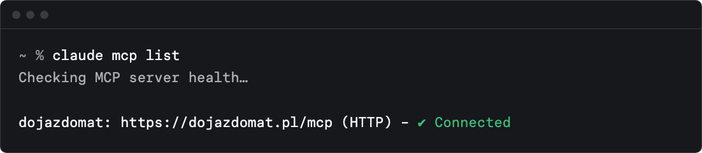

# Dojazdomat



Mapa Warszawy, która pokazuje, gdzie opłaca się wynająć mieszkanie, jeśli pracujesz w konkretnym miejscu: czas dojazdu komunikacją miejską od drzwi do drzwi zestawiony z czynszami z ogłoszeń.

Działa na https://dojazdomat.pl. Serwer MCP dla Claude i innych asystentów AI: `https://dojazdomat.pl/mcp` (opis w `mcp_server/README.md`).



*Mapa na dojazdomat.pl (listopad 2026). Serwer MCP (`mcp_server/`, `api/`) jest w aktualnej wersji 1.1.0; frontend w `web/` to wersja z 19 października 2026, wygląd strony od tego czasu się zmienił.*

## Co jest w repozytorium



- `web/`: statyczny frontend (Leaflet, bez frameworka). Liczy izochrony w przeglądarce z gotowej macierzy czasów przejazdu.
- `pipeline/transit/`: macierz czasów przystanek → przystanek z rozkładów GTFS (ZTM, SKM, metro, KM, WKD), średnia dla odjazdów 7:00–9:00 w dzień roboczy.
- `pipeline/walk/`: kalibracja dojścia pieszo na grafie ulic OpenStreetMap, punkty osiedli.
- `pipeline/load/`, `db/`: PostgreSQL + PostGIS (warstwy staging / core / mart, historia cen SCD2, reguła duplikatów w SQL).
- `api/`: FastAPI (siatka dojazdu, mediany czynszu, ranking osiedli).
- `mcp_server/`: serwer MCP zwracający tylko statystyki zbiorcze.
- `CONTRACT.md`: format plików danych, `ARCHITECTURE.md`: architektura.

## Serwer MCP (wersja 1.1.0)

Ten sam silnik odpowiada asystentom AI. Zwraca tylko zestawienia (cena od 20 ogłoszeń), nigdy pojedyncze ogłoszenia.

| Narzędzie | Co robi |
|---|---|
| `find_place` | szuka przystanku lub osiedla po nazwie i zwraca współrzędne |
| `commute_time` | czas dojazdu z domu do pracy: komunikacją (dni robocze 7–9), rowerem, pieszo albo autem w szczycie (`mode`) |
| `rent_stats` | mediana, kwartyle i liczba ogłoszeń w promieniu od punktu |
| `rank_neighborhoods` | ranking osiedli pod miejsce pracy: czynsz, dojazd, opłacalność, dla każdego sposobu dojazdu |
| `rank_for_two` | ranking osiedli dla dwóch osób pracujących w dwóch miejscach |
| `compare_neighborhoods` | porównanie 2–4 osiedli: mediana, kwartyle, liczba ogłoszeń, dojazd |
| `reachable_neighborhoods` | wszystkie osiedla, z których dojedziesz do danego miejsca w N minut |
| `rent_trend` | mediana czynszu dzień po dniu dla Warszawy, dzielnicy albo osiedla |
| `dataset_info` | daty danych, źródła, liczba ogłoszeń, ograniczenia metody |

Wszystkie narzędzia są tylko do odczytu. Serwer jest w oficjalnym katalogu MCP jako `io.github.MikolajSapek/dojazdomat`.

Dodanie w Claude Code:

```
claude mcp add --transport http dojazdomat https://dojazdomat.pl/mcp
```



Instrukcje dla Claude, ChatGPT, Cursor, VS Code i Codex: https://dojazdomat.pl/serwer-mcp

## Czego tu nie ma

Ogłoszeń. Repozytorium nie zawiera pobranych ogłoszeń ani scraperów portali: bazy ogłoszeń należą do portali i ich regulaminy ograniczają dalsze udostępnianie. Do uruchomienia lokalnie służą syntetyczne dane w `web/fixtures/` (`web/index.html?fixtures=1`). Własne pliki `web/data/listings-<źródło>.json` w formacie z `CONTRACT.md` frontend wczyta automatycznie.

## Uruchomienie

```
python3 -m http.server 8000 --directory web      # mapa: http://localhost:8000/?fixtures=1
python3 -m venv .venv && .venv/bin/pip install -r requirements.txt
.venv/bin/pytest -q tests                        # testy DB wymagają lokalnego PostgreSQL z PostGIS
```

## Dane i licencje źródeł

- Rozkłady jazdy: GTFS ZTM Warszawa, SKM, Koleje Mazowieckie, WKD (agregowane przez mkuran.pl).
- Ulice i granice: © OpenStreetMap contributors, ODbL.
- Podkład mapy: Esri, HERE, Garmin, © OpenStreetMap.
